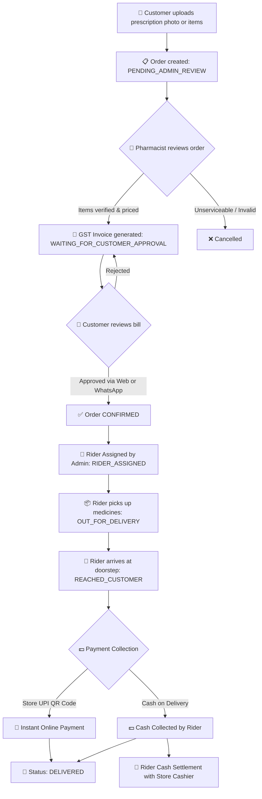
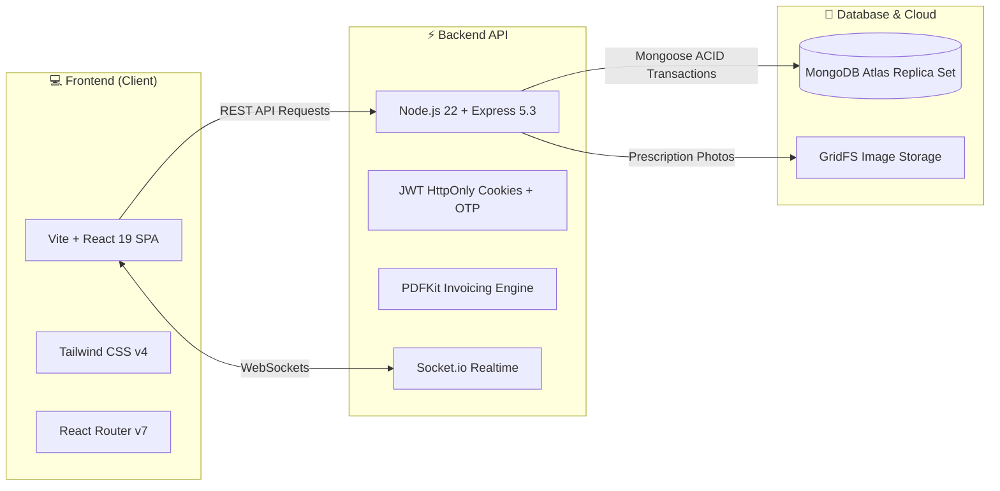

<div align="center">

# 🏥 Medical-Connect | CK Medical
### Hyperlocal Pharmacy Order, Prescription Billing & Home Delivery Platform

**A full-stack, real-time medicine ordering and logistics platform purpose-built for local chemists, pharmacies, and neighborhood delivery.**

---

[](https://medical-connect-pp2v.onrender.com)
[](https://github.com/rushi0369/Medical-Connect)
[](LICENSE)

<br/>

[](https://react.dev/)
[](https://www.typescriptlang.org/)
[](https://tailwindcss.com/)
[](https://nodejs.org/)
[](https://expressjs.com/)
[](https://www.mongodb.com/atlas)
[](https://socket.io/)

<br/>

[**🌐 Live Website**](https://medical-connect-pp2v.onrender.com) • [**🔑 Login Credentials**](#-test-login-credentials) • [**🔄 System Workflow**](#-order-lifecycle--workflow) • [**✨ Key Features**](#-key-features) • [**📍 Store Profile**](#-physical-store-location) • [**🛠️ Setup Guide**](#-local-development-setup)

</div>

---

## 🌟 The Problem & Solution

Traditional pharmacy e-commerce apps require thousands of pre-cataloged SKU items with rigid stock inventory counts. For local chemists, medicines go in and out of stock hourly, brands have equivalent generic substitutes, and patients frequently order by snapping a photo of their handwritten doctor's prescription.

**Medical-Connect solves this with an agile prescription-first approach:**

```
┌─────────────────────────┐      ┌─────────────────────────┐      ┌─────────────────────────┐
│   🛒 Customer Portal    │ ───► │  🏥 Pharmacist Admin    │ ───► │   🛵 Delivery Rider     │
│  Upload Prescription or │      │  Verify Shelf Stock,    │      │  Turn-by-turn Road GPS, │
│  Type Medicines From Bed│      │  Quote PDF Bill & GST   │      │  Collect Cash & UPI QR  │
└─────────────────────────┘      └─────────────────────────┘      └─────────────────────────┘
```

1. **Customers** snap a picture of their prescription or type medicine names and submit an order from home in seconds.
2. **Chemists & Pharmacists** review stock availability, suggest brand alternatives, generate itemized GST PDF invoices, and dispatch orders to riders.
3. **Delivery Riders** receive real-time road directions via Google Maps, collect payments (Store UPI QR or Cash), and reconcile cash handovers directly at the store.

---

## 🚀 Live Demo & Production Deployment

The entire stack is deployed and running live on **Render Cloud Infrastructure** backed by **MongoDB Atlas**:

| Service | Provider | Status | Live Link |
| :--- | :--- | :--- | :--- |
| **Unified Web App** | Render (Singapore) |  | [**medical-connect-pp2v.onrender.com**](https://medical-connect-pp2v.onrender.com) |
| **Cloud Database** | MongoDB Atlas Replica Set |  | Cloud Managed |
| **Health Monitor** | cron-job.org |  | Runs every 10 mins |

> [!TIP]
> You can open the live website directly on your smartphone or desktop browser to test all three interactive roles simultaneously.

---

## 🔑 Test Login Credentials

Three pre-configured role accounts are ready for testing on the live deployment:

| Role | Portal Link | Mobile Number | Password | Capabilities & Access |
| :--- | :--- | :--- | :--- | :--- |
| 🏥 **Admin (Pharmacist)** | [/login](https://medical-connect-pp2v.onrender.com/login) | `9876543210` | `Admin@123` | Prescription inspection, GST billing, dispatching riders, cash settlements, customer management |
| 🛒 **Customer** | [/login](https://medical-connect-pp2v.onrender.com/login) | `9876543211` | `Customer@123` | Prescription photo uploads, invoice approval, real-time tracking, 1-click medicine reorders |
| 🛵 **Delivery Rider** | [/login](https://medical-connect-pp2v.onrender.com/login) | `9876543212` | `Rider@123` | Delivery queue, Google Maps navigation, doorstep cash & UPI QR collections |

> [!NOTE]
> All passwords use standard demo credentials. Accounts can also reset passwords via self-service 6-digit OTP codes.

---

## 🔄 Order Lifecycle & Workflow

The following flowchart illustrates the complete lifecycle of a medicine request from initial prescription submission to doorstep delivery and payment settlement:



---

## ✨ Key Features

### 🛒 Customer Experience
* 📸 **Prescription Photo Upload**: Drag & drop doctor prescription images with secure cloud GridFS storage.
* 📝 **Custom Medicine Notes**: Request specific brand names, dosages, or OTC wellness products in Gujarati or English.
* 🧾 **Interactive Bill Approval**: View itemized pricing, discounts, delivery fees, and doctor-approved brand alternatives before confirming.
* 🔁 **1-Click Monthly Refill**: Easily reorder recurring medications with a single click from past order history.
* 📍 **Multiple Saved Addresses**: Save and switch between Home, Office, or Parents' addresses with GPS coordinate pinning.
* 🔒 **Self-Service Password Recovery**: Instant 6-digit OTP verification code via WhatsApp or on-screen recovery badge.

### 🏥 Pharmacist & Admin Command Center
* 🔍 **Dual Prescription Inspection Station**: Side-by-side prescription viewer with item availability toggles and alternative notes.
* 📄 **Automated GST Invoice Engine**: Clean PDF generation with pharmacy GSTIN, FSSAI license numbers, itemized CGST/SGST, and batch numbers.
* 💬 **1-Click WhatsApp Billing**: Direct `wa.me` integration to send itemized bills and approval links straight to the customer's phone.
* 🛵 **Smart Rider Dispatch**: Road distance estimation from the physical store to calculate delivery tiers dynamically.
* 💵 **Payment Reconciliation**: Track Cash on Delivery (COD) and Store UPI QR payments with rider cash handover settlements.
* 🔔 **Bilingual Refill Reminders**: Culturally crafted monthly refill messages in Gujarati and English with sacred blessings.
* ⚙️ **Store Profile & Location Setup**: Custom Store UPI QR image uploader and GPS store coordinate editor.
* 🗑️ **Universal Bulk Actions**: Select-All checkboxes and bulk deletion across Invoices, Orders, Payments, Customers, and Riders.

### 🛵 Delivery Rider Mobile App
* 📦 **Order Queue**: Mobile-first interface optimized for delivery agents on two-wheelers.
* 🗺️ **Turn-by-Turn Navigation**: One-tap deep link to Google Maps with optimized road routing to the customer's doorstep.
* 📲 **Doorstep UPI QR & Cash Collection**: Prompt customers to scan the store's static UPI QR code or collect exact cash.
* 🤝 **Rider Wallet & Settlement**: Track cash held in wallet until physical handover to the store cashier.

---

## 📍 Physical Store Location

The system is configured around the real-world location of **CK Medical**:

<div align="center">

| Property | Details |
| :--- | :--- |
| **🏪 Store Name** | **CK Medical** (Chemist & Druggist) |
| **📍 Address** | Mandvi Road, Near Mandvi Bus Depot, Char Rasta, Kim, Gujarat 394110 |
| **🌐 GPS Coordinates** | `21.4035° N, 72.9274° E` |
| **🚚 Delivery Origin** | All distance tiers and delivery route calculations originate from this physical store coordinate |

</div>

---

## 🛠️ System Architecture & Tech Stack



### Full Stack Breakdown

* **Frontend**: React 19, TypeScript, Vite 8, Tailwind CSS v4, Lucide React, React Hook Form, Zod.
* **Backend**: Node.js v22+, Express 5.3 (modern middleware routing & async error handling), Multer, PDFKit.
* **Database**: MongoDB Atlas with Mongoose ODM (utilizing ACID multi-document transactions & GridFS binary storage).
* **Security**: HTTP-Only Secure JWT Cookies, bcrypt password hashing, input sanitization, rate-limiting, CORS origin validation.

---

## 💻 Local Development Setup

### Prerequisites
* [Node.js](https://nodejs.org/) v22 or newer
* A free [MongoDB Atlas](https://www.mongodb.com/atlas) database cluster (or local MongoDB replica set)

### 1. Clone the Repository
```bash
git clone https://github.com/rushi0369/Medical-Connect.git
cd Medical-Connect
```

### 2. Configure Environment Variables
Create a `.env` file in the `backend/` directory:
```env
PORT=5000
NODE_ENV=development
MONGODB_URI=your_mongodb_atlas_connection_string/medicare?retryWrites=true&w=majority
JWT_SECRET=your_super_secret_key_minimum_32_characters_long
CLIENT_URL=http://localhost:5173
```

Create a `.env` file in the `frontend/` directory:
```env
VITE_API_URL=http://localhost:5000/api
```

### 3. Install Dependencies & Build
```bash
npm run build
```

### 4. Seed Initial Accounts
Populate your database with the default admin, customer, and rider accounts:
```bash
npm --prefix backend run seed:all
```

### 5. Launch Development Servers
```bash
# Terminal 1: Backend API (runs at http://localhost:5000)
cd backend && npm run dev

# Terminal 2: Frontend Client (runs at http://localhost:5173)
cd frontend && npm run dev
```

Visit **`http://localhost:5173`** in your browser!

---

## 🌐 Production Deployment (Single-Service Architecture)

This project features unified single-service production deployment where Express automatically serves the compiled Vite SPA static bundle:

1. **Deploy on [Render.com](https://render.com/)**:
   * Create a **New Web Service** connected to this repository.
   * **Runtime**: `Node`
   * **Build Command**: `npm run build`
   * **Start Command**: `npm start`
2. **Environment Variables on Render**:
   * `NODE_ENV`: `production`
   * `MONGODB_URI`: *Your MongoDB Atlas connection URI*
   * `JWT_SECRET`: *Your cryptographically secure secret string*
   * `CLIENT_URL`: `https://your-service-name.onrender.com`
3. **24/7 Keep-Alive (Zero Sleep)**:
   * Setup a free ping monitor on [cron-job.org](https://cron-job.org/) targeting `https://your-service-name.onrender.com/api/health` every 10 minutes.

---

## 📄 License

This project is open-source and licensed under the **ISC License**.

---

<div align="center">

Made with ❤️ for **CK Medical**, Mandvi Road, Kim Char Rasta, Gujarat.

[**Back to Top ⬆️**](#-medical-connect--ck-medical)

</div>
